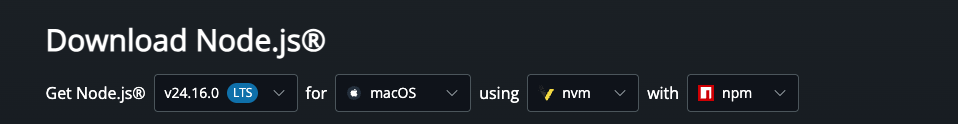
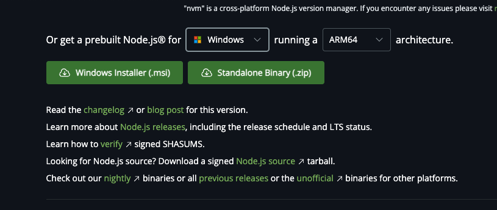
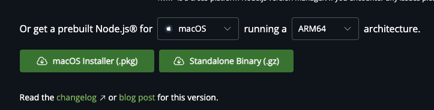
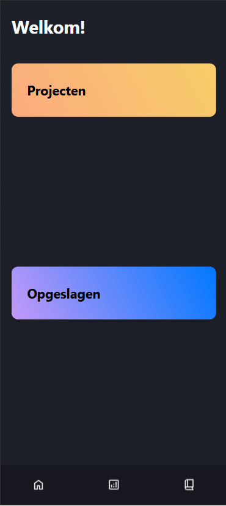
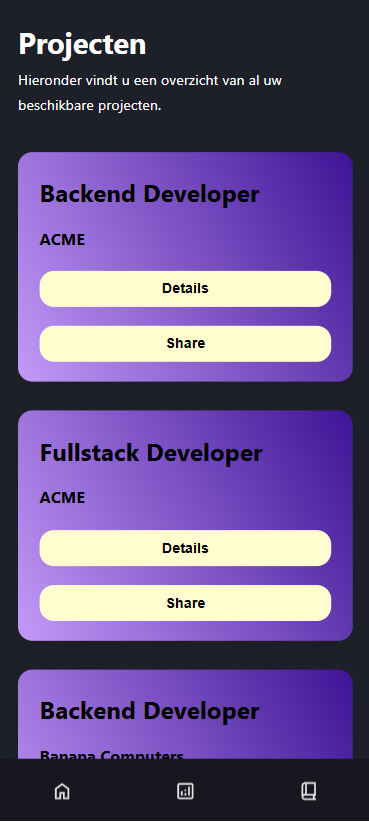
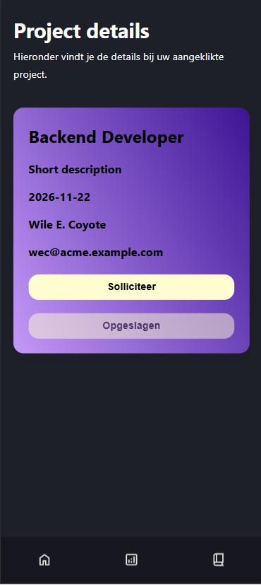
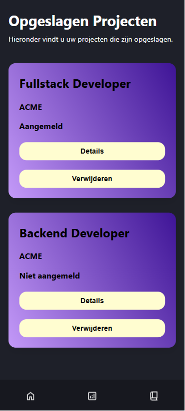

# Werkplaats 4 - Progressive Web Apps
__Gemaakt door:<br>__
-Donovan Feller (1073598)<br>
-Lucas Reedijk (1054292)<br>
-Taha Ditta (1088007)<br>

**Beschrijving:**<br>
Wij als groep 1C2 Hyena's, hebben een PWA (Progessive Web Application) gebouwd genaamd RACademic hierin kunnen studenten alle beschikbare afstudeerprojecten kunnen zien.
In deze applicatie kun je een overzicht van afstudeerprojecten, de functie, de naam van het bedrijf zien. Ook is er een details knop waarmee je extra informatie kan inzien bij een specifiek project daarnaast is er ook een share knop waarmee je een project kann delen met anderen.
Als de student op de details knop klikt, dan wordt hij verwezen naar een detail pagina met meer informatie over het afstudeerproject zoals: 
opnieuw de functie, een korte beschrijving, de start datum, de contact persoon, het e-mail adres, een knop om te solliciteren bij dit bedrijf
en een knop om dit project op jouw apparaat op te slaan. 
De studenten kunnen projecten opslaan en kunnen deze projecten terugvinden op een overzicht genaamd "Opgeslagen projecten". Als de student op "Solliciteren" klikt,
dan wordt de student doorverwezen naar een mail programma (bijvoorbeeld outlook) en wordt er een mail venster met het ingevulde e-mail adres van het bedrijf, de gekozen functie in het onderwerp klaargezet. 
Vervolgens kan de student zelf de tekst van de e-mail opzetten en de mail versturen. 

Dit alles is zo verwerkt dat het voor de gebruiker toegankelijk is en fijn in gebruik. Ook hebben we de WCAG-richtlijnen opgevolgd voor optimale gebruiksvriendelijk voor gebruikers.

__Notitie:__
Het is mogelijk dat spacing of bepaalde images niet zichtbaar zijn in de README.md van GitHub zelf, wees niet getreurd! Je kan dit oplossen door de README.md te openen in je IDE ;)


**Instructies voor installatie:**<br>
In stappen hieronder zal ik beschrijven hoe u onze bestanden kunt installeren:
1. Download onze zip file
2. Haal de folder uit die zipfile (het is de bedoeling dat je 1 folder hebt waarin alle bestanden en overige folders behorend bij het project staan, als u dit heeft dan is dat voldaan)
3. Open de folder met een door u gekozen IDE (bijvoorbeeld PyCharm of Visual Studio Code)
4. Installeer de benodigdheden het bestand genaamd "requirements.txt" (zie command hieronder)
<br>
<br>
- **macOS gebruikers:** op macOS kan het zijn dat de onderstaande commands niet werken, gebruik dan pip3 in plaats van pip & python3 in plaats van python bij de commands. 
<br>
````
```
pip install -r requirements.txt
```
````

__Vervolgens hebt u NodeJS nodig.__  
Dit kunt u via de volgende link downloaden: <br>
https://nodejs.org/en/download <br>

1. Zorg dat u LTS kiest.  <br>

<br>
<br>
2. Voor **Windows** download .msi en voor **macOS** download .pkg. <br>

<br>
<br>

<br>
<br>
3. Als de installatie klaar is, open terminal en voer de onderstaande command uit. 
````
```
node -v
```
````
<br>
4. Zie je een versienummer, dan is het gelukt.
<br>

5. Run daarna in het project de benodigde pakketen: npm install en npm install react-router-dom. Nu kun je npm run dev gebruiken 
<br>
__Als eerst de onderstaande:__
````
```
npm install
```
````


__Vervolgens de tweede:__
````
```
npm install react-router-dom
```
````
<br>

6. Ook moet u de docker desktop app gedownload & geïnstalleerd hebben. Deze kunt u via de volgende link downloaden: <br>
Windows: https://docs.docker.com/desktop/setup/install/windows-install/
<br>macOS: https://docs.docker.com/desktop/setup/install/mac-install/
<br>
<br>
7. Voor de installatie zie de folder genaamd: __"Handleidingen"__ in de docs folder.
<br>
<br>
8. Als je dit allemaal gedaan hebt ben je klaar met de installatie (zie opstart instructies om het project op te kunnen starten)

__BELANGRIJK:__
Als er iets mis is gegaan of de installatie is mislukt, begin dan opnieuw vanaf stap 1.
<br>

**Instructies voor het opstarten:**<br>
Hieronder zal ik beschrijven hoe u onze web-applicatie opstart nadat u de bestanden in een IDE open hebt staan (en de installatie instructies hebt opgevolgd):

- run het onderstaande command in je terminal:

**LET OP:** Zorg ervoor dat je voor het runnen van de onderstaande command Docker hebt opgestart en (vaak linksonderin) "Engine running" ziet staan, zodra je dit ziet kan je de onderstaande command uitvoeren.

````
```
npm run dev
```
````

<br>
__Downloaden van onze applicatie:__

Chrome --> bij het "Meer (3 puntjes) menu" casten, opslaan en delen --> Pagina installeren als app <br>
Brave --> bij het "Meer (3 streepjes) menu" --> save and share --> Pagina installeren als app <br>
<br>
<br>
__Bij offline gebruik:__
Mocht u na het refreshen van de pagina tijdens offline gebruik een wit scherm zien/krijgen.
<br>
- Windows: klik dan op F5 
<br>
- Command + R

<br>
Hierna zal de app weer probleemloos offline verder werken.

**Screenshots**<br>
- __Homescreen:__ <br>

<br>
<br>

- __Lijst van projecten:__ <br>

<br>
<br>

- __Project details:__ <br>

<br>
<br>

- __Opgeslagen projecten:__ <br>

<br>
<br>

**Video**<br>
https://github.com/user-attachments/assets/6c458c36-2465-4150-8450-11e8e062a6e0


**Andere dingen die je wilt melden of belangrijk zijn**: <br>
Dit is bij ons project niet van toepassing


**Links naar relevante pull requests (Async programmeren):** <br>
- relevante Pull Requests Donovan Feller:
https://github.com/Rac-Software-Development/wp4-2026-pwa-1c2-hyena/pull/10/changes

- relevante Pull Requests Taha Ditta: 
https://github.com/Rac-Software-Development/wp4-2026-pwa-1c2-hyena/pull/19

- relevante Pull Requests Lucas Reedijk:
https://github.com/Rac-Software-Development/wp4-2026-pwa-1c2-hyena/pull/24/changes 

**Apa Bronnen**<br>
- Bronnenlijst Donovan Feller:
[Bronvermelding_Donovan_Feller_1073598_WP4.pdf](docs/Bronnen/Bronvermelding_Donovan_Feller_1073598_WP4.pdf)
- Bronnenlijst Taha Ditta: 
[Bronnenlijst wp4 - Taha Ditta 1088007.docx](docs/Bronnen/Bronnenlijst%20wp4%20-%20Taha%20Ditta%201088007.docx)
- Bronnenlijst Lucas Reedijk: 
[Bronnenlijst Lucas Reedijk.docx](docs/Bronnen/Bronnenlijst%20Lucas%20Reedijk.docx)

